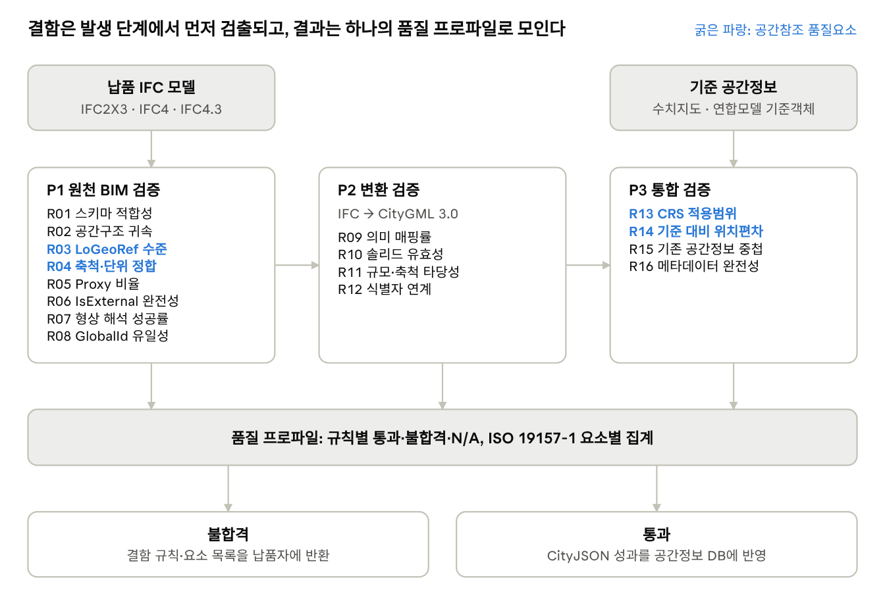

# 건축물 BIM–GIS 연계 데이터의 단계별 품질 검증 체계(BG-QVF)

논문 「건축물 BIM–GIS 연계 데이터의 단계별 품질 검증 체계 설계 및 결함 주입 기반 실증」(한국콘텐츠학회논문지 투고 원고)의
검증 체계 구현 코드, 실험 스크립트, 변환 결과와 실험 원자료입니다.

BG-QVF는 IFC 건물 모델을 CityGML 3.0(CityJSON 2.0)으로 옮겨 GIS에 통합하는 과정을 세 단계로 나누어 검사합니다.

| 단계 | 내용 | 규칙 |
|---|---|---|
| P1 원천 BIM 검증 | 스키마, 식별자, 공간참조(LoGeoRef), 분류, 속성, 솔리드 | R01–R08 |
| P2 변환 검증 | 의미 매핑률, LoD1 형상 유효성, 형상 타당 범위, 메타데이터 | R09–R12 |
| P3 통합 검증 | 좌표계 일치, 위치 편차(Hausdorff), 기존 레이어와의 중첩, 식별자 추적성 | R13–R16 |



## 폴더 구성

```
qvf.py              검사 규칙 16개(P1/P2/P3)와 IFC → CityGML 3.0(CityJSON) 변환기
e1_analysis.py      E1  공개 건물 IFC 7종 분석(IV장)
e2_mutation.py      E2  결함 주입 실험 M1–M10(V장 1–3절)
e2_analyze.py       E2  결과 집계(결함 유형별·검사 구성별·기준 모델별)
e3_sweep.py         E3  원점 이동·회전 민감도(V장 4절)
fig_cases.py        그림 3·4 생성
extra_checks.py     기본 출력에 저장되지 않는 본문 수치 재현
e2_rerun_m5.py      기록용(아래 '참고' 참조)
download_data.py    실험 데이터 9개를 고정 커밋에서 내려받고 SHA-256 확인
out/                실험 원자료(JSON), 변환 결과(*.city.json), 그림 3·4
docs/figures/       논문 그림 1–4
```

## 논문 표·그림과 파일의 대응

| 논문 | 생성 스크립트 | 결과 파일 |
|---|---|---|
| 표 4 대표 사례 4종의 품질 프로파일 | e1_analysis.py | out/e1_results.json |
| 표 B1 7개 모델 전체의 판정 결과 | e1_analysis.py | out/e1_results.json |
| 그림 3 대표 사례 4종의 변환 결과 | e1_analysis.py → fig_cases.py | out/fig3_cases_3d.png, out/*.city.json |
| 표 5 주입 결함과 탐지 결과 | e2_mutation.py → e2_analyze.py | out/e2_raw.json → out/e2_summary.json (`by_type`) |
| 표 6 검사 구성별 탐지율 | e2_analyze.py | out/e2_summary.json (`by_conf`) |
| 그림 2 공간참조 오류의 민감도 | e3_sweep.py | out/e3_sweep.json |
| 그림 4 공간참조 결함 전후 평면 | fig_cases.py | out/fig4_georef_faults.png |
| 본문 보조 수치(병합 메시 R10, τ 민감도, 임계 회전각 등) | extra_checks.py | out/extra_checks.json |
| 부록 A 코드 A1–A3 | qvf.py, e2_mutation.py | – |

그림 1(체계 구조)은 개념도로, 코드로 생성하지 않습니다.

## 실험 데이터

모두 공개 건물 IFC입니다. `download_data.py`가 논문 실험에 쓴 것과 같은 커밋에서 내려받아 해시를 확인합니다.

| 기호 | 파일 | 출처 | 역할 |
|---|---|---|---|
| B1 | Building-Architecture.ifc | buildingSMART Sample-Test-Files, IFC 4.3.2.0 Simple-Scene (CC BY 4.0) | 분석·결함 주입 |
| B2 | Building-Structural.ifc | 〃 | 분석·결함 주입 |
| – | Building-Hvac.ifc, Building-Landscaping.ifc | 〃 | 분석 |
| – | Infra-Road.ifc, Infra-Rail.ifc | 〃 | R15 비교용 기존 도로·철도 레이어(분석 대상 아님) |
| B3 | AC11-FZK-Haus-IFC.ifc | opensourceBIM TestFiles, TestData/data | 분석·결함 주입 |
| – | AC11-Institute-Var-2-IFC.ifc | 〃 | 분석 |
| B4 | AC-20-Smiley-West-10-Bldg_fix.ifc | 〃 | 분석·결함 주입 |

- buildingSMART: https://github.com/buildingSMART/Sample-Test-Files (commit `5030f65`)
- opensourceBIM: https://github.com/opensourceBIM/TestFiles (commit `2fdf948`). 라이선스가 명시되어 있지 않아 원본 IFC는 이 저장소에 넣지 않았습니다.

## 실행 방법

Python 3.11 이상(실험은 3.13에서 수행).

```bash
git clone https://github.com/0613jihui/bim-gis-quality-verification.git
cd bim-gis-quality-verification
python -m venv .venv && source .venv/bin/activate      # 윈도우: .venv\Scripts\activate
pip install -r requirements.txt
python download_data.py                                # bs43/, osb/ 폴더 생성

python e1_analysis.py      # 약 2분
python e2_mutation.py      # 가장 오래 걸림(131개 변이 모델). B1,B2처럼 기준 모델만 지정해 다시 실행 가능
python e2_analyze.py
python e3_sweep.py
python fig_cases.py
python extra_checks.py
```

모든 스크립트는 저장소 최상위 폴더에서 실행합니다. `out/`의 결과 파일은 덮어써지며,
`e1_analysis.py`를 다시 실행했을 때 실행 시간(`seconds`) 외의 값은 저장된 결과와 같음을 확인했습니다.

## 실험 환경

ifcopenshell 0.9.0, shapely 2.2, trimesh 5.2, pyproj 3.8(PROJ 9.8), mapbox_earcut 2.1, numpy 2.5, matplotlib 3.11

## 주요 결과 요약

- E1: 7개 모델 × 해당 규칙 99건 중 20건(20.2%) 불합격
- E2: 변이 모델 131개 중 109개(83.2%) 탐지. 스키마 검증만으로는 13.7%, P3 통합 검증 추가로 +25.2%p
- E3: 1° 회전 시 위치 편차 B1 0.21 m, B4 1.32 m. τ = 0.20 m 기준 임계 회전각은 0.15–1.16°

## 참고

결함 M5(분류 손실)는 초기 실행에서 재분류 후 기존 PredefinedType이 남아 스키마 위반이 함께 발생했습니다.
PredefinedType을 정리하도록 `e2_mutation.py`를 고친 뒤 M5만 다시 실행했으며, `out/e2_raw.json`과 논문 수치는 수정 후 결과입니다.
`e2_rerun_m5.py`는 그 재실행 과정을 남긴 기록용 스크립트입니다.
